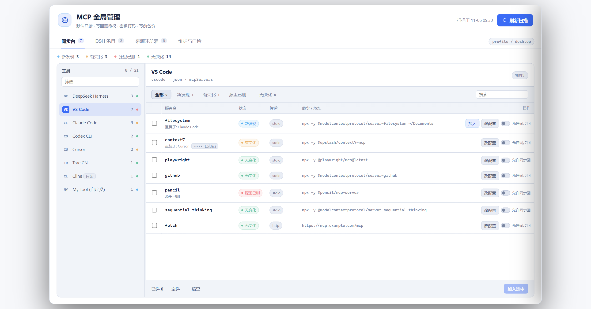
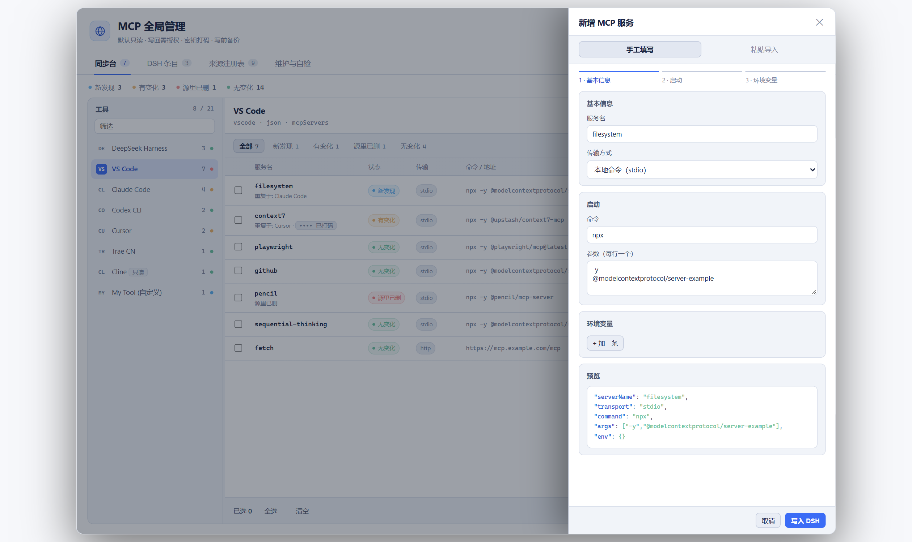
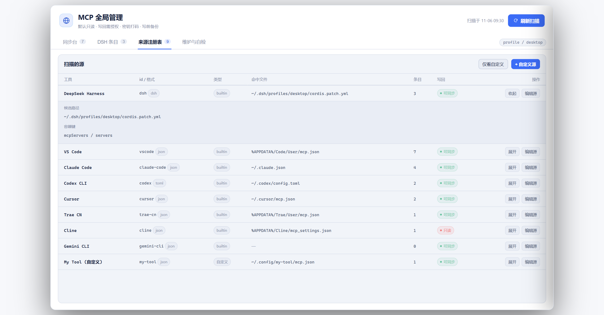
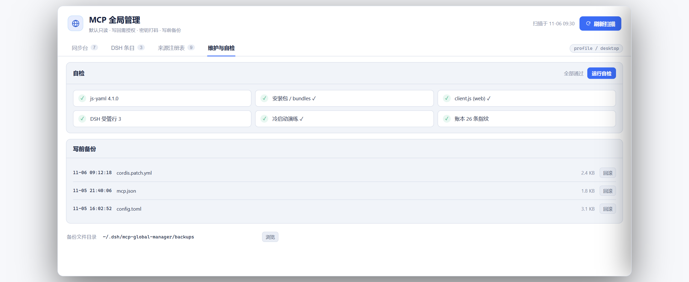

# dsh-mcp-global-manager

> 🌐 中文文档 / Chinese docs: [README.md](./README.md) · The Chinese README is the canonical documentation for this plugin.

A DSH sidebar panel that gathers MCP configs scattered across the tools on your machine into one place — scan diffs → adopt into DSH with one click → write back to the original tool when needed → add / edit / remove / disable MCP servers directly from the DSH side.

*DSH 侧栏面板：把散落在本机各编程工具里的 MCP 配置收进一处——扫描差异 → 一键采纳进 DSH → 需要时写回原工具 → DSH 侧直接增删改停用。*

MIT · Windows / macOS / Linux · DSH ≥ 0.1.0-rc.6 · no network egress · no command execution

## Screenshots

> These screenshots are rendered from the current UI with sample data only. All paths use generic `~` / `%APPDATA%` placeholders; no real configuration is shown.

**① Sync desk** — four status counters (new / changed / missing / in-sync) on top, sources grouped in the left rail, and a diff table on the right. Select rows and click **Adopt selected** to write them into DSH; a tool's config file is changed only after you enable **Allow push-back** on that entry:



**② Add DSH entry** — a three-step drawer form (basic info / launch / env vars), or switch to **Paste import** to parse a whole config block; the live preview at the bottom shows exactly what will be written:



**③ Source registry** — built-in and custom sources at a glance, each with a `builtin` / read-only / syncable badge and its matched file. Click **Expand** to see multi-platform candidate paths and the container key:



**④ Maintenance & self-check** — a one-click six-item check (js-yaml / install / client.js / DSH-managed rows / cold start / ledger fingerprints), plus the pre-write backup list and backup directory setting:



---

## Why it exists

MCP configs live in the config files of 28 registered sources (Claude Code / Codex / VS Code / Cursor / Trae / Kiro / OpenCode / Cline / Gemini CLI … plus custom sources). The same server (e.g. `pencil` appearing in 5 tools) gets edited in one place and forgotten in three. This plugin does three things:

1. **Discover** — scans each tool's config per the registry, recognizing each dialect (JSON / TOML / OpenCode / Continue array form; `//` comments and trailing commas are tolerated).
2. **Sync** — writes selected entries into the DSH profile's `cordis.patch.yml`, generating `@deepseek-ai/dsh-mcp-client` managed rows (row shape is interoperable with `dsh-mcp-manager-plus`).
3. **Manage** — add / edit / remove / disable on the DSH side; writing back to the original tool requires explicit per-entry authorization.

Sidebar entry: a globe icon + **MCP全局管理** (`order: 22`, right after dsh-remote-web-ui's "remote link" at 21; works fine without that plugin).

## Features

- **Scan**: 28 built-in + custom sources; 400ms request-level cache so spam-clicking "refresh scan" won't thrash the disk.
- **Diff ledger**: `in-sync / new / changed / removed-from-source` fingerprinting; JSON key reordering won't false-positive; same-named entries call each other out across tools (`duplicated in: Trae CN, Cursor`).
- **Adopt / import**: batch or single selection; the `--emit` preview and the real import share one pure function, so "what it says it writes" = "what it actually writes".
- **Write back**: per-entry "allow write-back" toggle + confirm dialog + a server-side ledger double gate; **there is no `force` bypass parameter**.
- **DSH-side management**: add / edit / remove / disable; structural validation before every write; refuses to delete rather than mis-detect the main row.
- **Secret safety**: env keys / headers matching `KEY|PASSWORD|SECRET|TOKEN|AUTH|BEARER|COOKIE|CRED` (case-insensitive) and same-named tokens in URL query strings are masked in the UI; on write-back the server restores the real disk value per field, and 409-rejects if it can't (the source never had the real value) — no config file ever receives those eight dots.
- **Backups**: every write is auto-backed-up to `~/.dsh/mcp-global-manager/backups/`, keeping up to 40 copies.
- **Self-check**: one click outputs js-yaml availability / the three client-bundle items / DSH-managed row count — specifically for "works now, breaks after restart".
- **Bilingual UI**: Chinese/English text follows the DSH language.

## Install

Use DSH's built-in plugin command; replace `--profile` with the profile you actually use (`web` / `desktop` / `tui` …):

```powershell
# ① From GitHub (recommended, no npm account needed)
dsh plugin --profile web add asfre/dsh-mcp-global-manager

# ② From source (dev mode)
dsh plugin --profile web add file:C:/Users/you/dsh-plugins/dsh-mcp-global-manager

# ③ From a prebuilt tarball on GitHub Releases (pin the version)
dsh plugin --profile web add https://github.com/asfre/dsh-mcp-global-manager/releases/download/v0.2.0/dsh-mcp-global-manager-0.2.0.tgz
```

> Not yet published to npm; once published, step ① can become `dsh plugin --profile web add dsh-mcp-global-manager` (the market will additionally show download counts).

After installing, **fully restart** DSH (right-click the tray icon → quit → reopen — `Ctrl+R` only reloads the frontend; the host process still runs the old `lib/*.js`). **MCP全局管理** will appear right below "remote link" in the sidebar.

## How to use the panel

1. Click **MCP全局管理** in the sidebar, then **refresh scan** at the top.
2. The badge row: total / new / changed / removed-from-source / managed-by-DSH / files present / read errors.
3. Each source under "MCP configs of each tool" is a block: check → **adopt selected**, or single **adopt to DSH**.
4. **Edit config** per entry; enable **allow write-back** first to reveal **write back to tool / delete from tool** (these edit the other tool's config file and prompt a confirm box).
5. On the "DSH side" do add / edit / remove / disable; **add DSH entry** creates one by hand.
6. "Removed from source" is only flagged red, never auto-deleted — delete it yourself; to fully reset the ledger, delete `~/.dsh/mcp-global-manager/state.json` for a fresh scan next time.
7. Server names are normalized before entering DSH (non-`[A-Za-z0-9_-]` chars dropped: `API 文档` → `API`, pure Chinese → `server-<hash6>`); the panel prompts to rename.

## Setting the backup directory

Under **Maintenance & self-check → Pre-write backup → Backup directory**, the quickest route is to **paste an absolute path and press Enter**, e.g. `C:/Users/<you>/.dsh/mcp-global-manager/backups`. Windows backslashes are accepted too and normalized to forward slashes on disk.

- **Browse**: opens a native system folder dialog first — Electron's own dialog when available, otherwise the host process calls the OS dialog directly (Windows / macOS / Linux implementations included). It returns a full absolute path, so **empty folders work fine**.
- **Fallback**: if neither a native dialog nor the browser directory API is available, the panel focuses the input and asks you to paste a path instead of trapping you in a re-select loop. A browser file picker may only yield a bare folder name; the host resolves it against the plugin data dir, `~/.dsh`, and your home directory, and returns an actionable error if nothing matches.
- Missing directories are created automatically. Only absolute paths are accepted; names containing `..` or path separators are never guessed.
- The setting lives in `settings.backupDir` of `~/.dsh/mcp-global-manager/state.json` and survives plugin upgrades.

## Security & permissions (disclosure)

**What it does:**

- **Read**: scans each tool's MCP config files in the registry (read-only by default). Sources flagged read-only (lingma / cherry-studio / zed / warp / continue) are blocked with 403 on write-back.
- **Write**: only two places — ① adopting / DSH-side management writes the profile's `cordis.patch.yml` (validate → backup → atomic write); ② only after you enabled "allow write-back" on an entry and confirmed, it writes that tool's own config file.
- **On-disk data**: only `~/.dsh/mcp-global-manager/` (`state.json` diff ledger + `backups/` pre-write backups), outside the plugin directory and not distributed with the repo.

**What it does NOT do:**

- **No network**: the host side opens no outbound connections; the browser side only talks to the local `/mcp-global/*`. No upload, no reporting of your config.
- **No command execution**: it will not run `npx` / `git` / download scripts to install MCP servers; it only edits config text.
- **No secrets needed**: the plugin holds no independent credentials of its own; it only carries tokens already in your config (masked on display and in API responses). To be frank: the diff ledger `state.json` keeps a **last-known raw-value snapshot** for each scanned entry (including plaintext tokens in env) for "missing-entry restore" and write-back recovery — it stays on your local disk only and never leaves the machine. On multi-user or remotely-controlled machines, watch the directory permissions of `~/.dsh/mcp-global-manager/`.
- **No privilege escalation**: the API listens on loopback only, and Origin must equal Host, with Host being a literal `127.x.x.x / localhost / [::1]` (blocks DNS rebinding). Same-site CSRF is always 403. Also note: **loopback ports are visible to any local process** — don't rely on this isolation on machines running untrusted programs. Local scripts without `Origin`, and the desktop shell using a custom protocol origin, are normally allowed.
- **No privilege escalation**: uses only the current logged-in user's file permissions.

⚠️ Note: some tools (e.g. Trae CN's Apifox entry) store tokens **in plaintext** in their own config; this plugin does not change that — don't paste those files to others or commit them to a repo.

**Write-back integrity**: every disk write goes `read original → pure-function edit → structural validate → read-back verify → backup → atomic write`; if any step fails the whole operation is cancelled and not a single byte on disk changes.

## Custom sources

For a new tool beyond the built-in list: add a custom source in the panel's "scanned sources" (id / format / container key / candidate paths, with `%APPDATA%`-style env expansion); only sources flagged "allow write-back" actually write.

## Compatibility matrix

`package.json` declares `engines.dsh: ">=0.1.0-rc.6 <0.3.0-0"` and uses **feature-detection** rather than version sniffing: missing `webServer` / `ctx.slots` / `locale` each degrade gracefully without crashing the plugin or the host.

| DSH version | Support | Sidebar entry behavior | Notes |
| --- | --- | --- | --- |
| `< 0.1.0-rc.6` | ❌ unsupported | entry not registered | most plugins self-disable on such old versions; panel shows an "environment unavailable" banner, not a blank screen |
| `0.1.0-rc.6` ~ `0.1.4` | ⚠️ limited | no standard sidebar entry | early `ctx.slots` missing; panel can't mount — upgrade DSH |
| `0.1.5` ~ `0.2.0-rc.x` | ✅ supported | standard sidebar entry (icon in left nav) | recommended range |
| `0.2.1-rc.x` ~ `0.2.2-rc.1` | ✅ supported | Plugins tab entry (next to Installed) | current best practice |
| `≥ 0.3.0` (unreleased) | ❓ to be verified | — | `engines.dsh` ceiling is `<0.3.0-0`; re-evaluate and raise the ceiling when the new major ships |

**Environment requirements & degradation:**

- **Host form**: the panel needs DSH's **web / desktop** build to provide the local scan API (depends on the host `webServer`). On headless / TUI or a host without `webServer`, the panel shows a clear "environment unavailable" banner (with the detected DSH version and reason) instead of a blank or error.
- **Language**: UI text has a built-in zh/en dictionary. When the `ctx.locale` service is missing (some old versions), it falls back to the built-in Chinese dictionary instead of rendering key names.
- **Theme**: colors all use DSH's official `--dsw-alias-*` tokens, with a built-in dark fallback when not injected; no dependency on any third-party appearance plugin.

## Known limitations

- JSON write-back drops `//`, `/* */` comments and trailing commas (reads are tolerant, can't restore them); a backup is always taken first, so you can roll back.
- TOML only handles one level of `[mcp_servers.x]`; `.env` / `.http_headers` sub-tables flatten to `env = { K = "V" }` on write-back.
- The panel manages **config**, not DSH's MCP runtime state (whether a server actually starts depends on DSH's MCP layer).
- The patch `id` namespace is shared across the whole profile: disable / delete / rename all first confirm the managed server row exists in the patch, and 409/404-reject if the main row can't be found. Avoid prefixes that collide with plugin names like `manager-plus`.
- DSH 0.2.2+ requires the host Node.js ≥ 24.9.

## Dev & self-test (zero writes)

```powershell
node tools/cli-scan.mjs            # scan & print only; --emit previews the import YAML
node test/run.mjs                  # backend unit tests (incl. write-path sandbox drills)
node tools/smoke-client.mjs        # panel render smoke test (React stub, catches full-page white screen)
node tools/cold-start-check.mjs    # cold-start drill: equivalent to "the user's first click after restart"
```

After editing source, sync into the profile: `powershell -ExecutionPolicy Bypass -File tools/sync-to-profile.ps1`, then `Ctrl+R` (client only) or full restart (host `lib/*.js`) depending on what changed.

⚠️ **js-yaml version pitfall** (the most common community "breaks after restart"): the patch dialect depends on js-yaml 4.x's `Type` constructor. `package.json` pins it as a direct `dependency`, but the profile's hoisted dir may be occupied by another plugin's 5.x. `resolveYaml()` picks a copy by capability (standard parse → `.pnpm/js-yaml@4.x` → neighbor-dir fallback). After installing, restart and click **self-check** once.

## Uninstall

Remove the dependency from the profile (`dsh plugin remove` or delete the entry in `dsh.profile.bundles`), then refresh the UI. The `mcp-*` rows already generated in the DSH patch will **not** disappear — those are your config, not the plugin's; delete them per-entry in the panel if you want. The ledger and backups are under `~/.dsh/mcp-global-manager/`; delete them too for a full cleanup.

## Changelog

Each version's "what changed + compatible harness version" is recorded bilingually in [CHANGELOG.md](./CHANGELOG.md), and also serves as the GitHub Release notes.

## License

MIT
