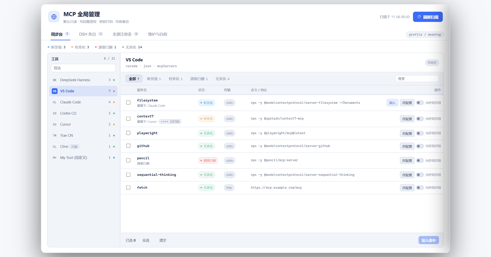
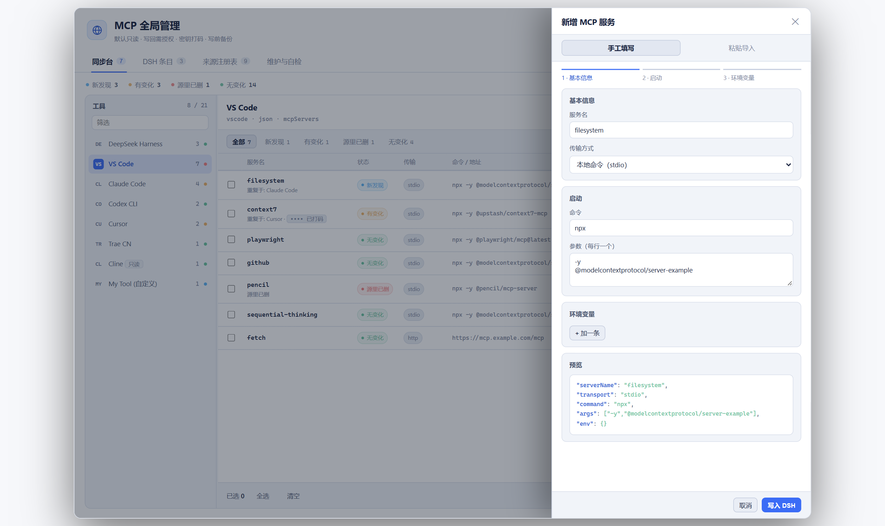
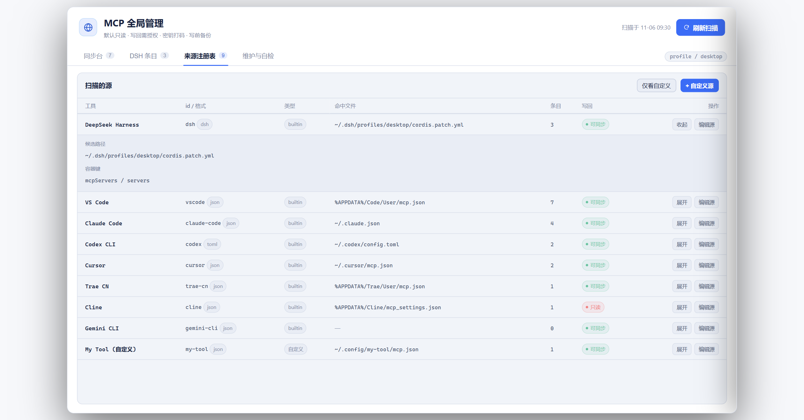
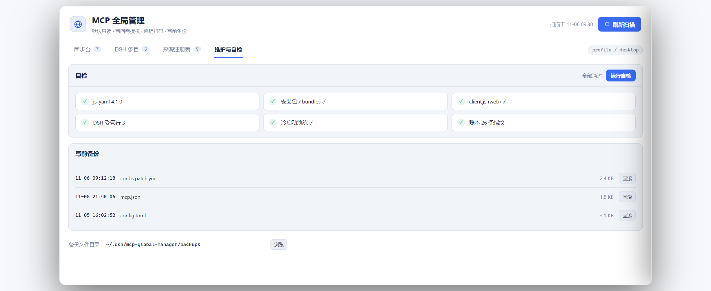

# dsh-mcp-global-manager

> 🌐 English documentation: [README.en.md](./README.en.md) · 中文说明是本插件的默认文档。

DSH 侧栏面板：把散落在本机各编程工具里的 MCP 配置收进一处——扫描差异 → 一键加入 DSH → 需要时同步回原工具 → DSH 侧直接增删改停用。

*A DSH sidebar panel that scans MCP configs from the tools it knows (28 built-in sources plus custom ones), syncs diffs into DSH, and lets you import, push back, or edit MCP servers.*

MIT · Windows / macOS / Linux · DSH ≥ 0.1.0-rc.6 · 不出网 · 不执行命令

## 界面速览

> 以下截图由当前版本界面渲染，全部使用示例数据；路径一律写作 `~` / `%APPDATA%` 等通用占位，不含任何真实配置。

**① 同步台** —— 顶部四态计数（新发现 / 有变化 / 源里已删 / 无变化），左侧按工具分组，右侧是差异明细表；勾选后点「加入选中」写进 DSH，逐条开启「允许同步回」才会改动原工具的配置文件：



**② 新增 DSH 条目** —— 右侧抽屉里的三步表单（基本信息 / 启动 / 环境变量），也可切到「粘贴导入」整段识别；底部实时预览将要写入的内容：



**③ 来源注册表** —— 内置源与自定义源一览，每条带 `builtin` / 只读 / 可同步 徽章和命中文件；点「展开」查看多平台候选路径与容器键：



**④ 维护与自检** —— 一键自检六项（js-yaml / 安装包 / client.js / DSH 受管行 / 冷启动 / 账本指纹），下方是写前备份列表与备份目录设置：



---

## 为什么需要它

MCP 配置散在 Claude Code / Codex / VS Code / Cursor / Trae / Kiro / OpenCode / Cline / Gemini CLI 等 28 个已登记源（外加自定义源）的配置文件里，同名条目（比如 `pencil` 出现在 5 个工具里）改一处忘三处。这个插件做三件事：

1. **发现**：按注册表扫每个工具的配置文件，识别各自方言（JSON / TOML / OpenCode / Continue 数组形态，`//` 注释与尾随逗号都能吃）。
2. **同步**：勾选后写进 DSH profile 的 `cordis.patch.yml`，生成 `@deepseek-ai/dsh-mcp-client` 受管行（与 `dsh-mcp-manager-plus` 的行形状互通，彼此认得对方的行）。
3. **管理**：DSH 侧的新增 / 编辑 / 删除 / 停用直接在面板做；同步回原工具需在条目上逐条显式授权。

侧栏入口：地球图标 + **MCP全局管理**（`order: 22`，排在 dsh-remote-web-ui「远程链接」的 21 后面；没装那个插件也照常可用）。

## 功能一览

- **扫描**：28 个内置源 + 自定义源；400ms 请求级缓存，连点「刷新扫描」不会把磁盘扫穿。
- **差异账本**：`无变化 / 新发现 / 有变化 / 源里已删` 四态指纹；JSON 键序重排不误报；同名条目跨工具互相点名（`重复于: Trae CN, Cursor`）。
- **加入 DSH**：勾选批量或单条导入；`--emit` 预览与真实导入共用同一个纯函数，「说写几行」＝「真写几行」。
- **同步回原工具**：逐条打开「允许同步回」＋ 确认弹窗 ＋ 服务端账本双重闸门；**没有任何 force 旁路参数**。
- **DSH 侧管理**：增删改停用；每次写盘前做结构校验，认不出主行宁可拒绝也不误删。
- **密钥安全**：名字命中 `KEY`/`PASSWORD`/`SECRET`/`TOKEN`/`AUTH`/`BEARER`/`COOKIE`/`CRED` 任一（不分大小写）的 env 键与请求头，以及 URL 查询串里的同名令牌，面板一律打码显示；同步回时服务端用磁盘原值逐条还原，还原不了（源文件里压根没有这条真值）直接 409 拒写——任何配置文件都不会被写进那八个圆点。
- **备份**：每次写入前自动备份到 `~/.dsh/mcp-global-manager/backups/`，最多保留 40 份。
- **自检**：一键输出 js-yaml 可用性 / 客户端包三项 / DSH 受管行数，专治「现在能用、重启就崩」。
- **双语界面**：中英文案跟随 DSH 语言。

## 安装

用 DSH 自带的插件命令，`--profile` 换成你实际在用的 profile 名（`web` / `desktop` / `tui` …）：

```powershell
# ① 从 GitHub 装（推荐，无需 npm 账号）
dsh plugin --profile web add asfre/dsh-mcp-global-manager

# ② 从源码装（开发态）
dsh plugin --profile web add file:C:/Users/you/dsh-plugins/dsh-mcp-global-manager

# ③ 装 GitHub Release 上的预构建 tarball（需先发版，版本号钉死）
dsh plugin --profile web add https://github.com/asfre/dsh-mcp-global-manager/releases/download/v0.2.0/dsh-mcp-global-manager-0.2.0.tgz
```

> npm 尚未发布；发布后第 ① 步可改用 `dsh plugin --profile web add dsh-mcp-global-manager`（市场会额外显示下载量）。

装完**彻底重启** DSH（托盘右键退出再打开——`Ctrl+R` 只重载前端，宿主进程里的 `lib/*.js` 还是旧的），侧栏「远程链接」正下方就会出现 **MCP全局管理**。

## 面板怎么用

1. 侧栏点 **MCP全局管理**，顶部 **刷新扫描**。
2. 徽章一行：总数 / 新发现 / 有变化 / 源里已删 / DSH 已管 / 存在的文件 / 读取失败。
3. 「各工具的 MCP 配置」每个源一块：勾选 → **加入选中**；或单条 **加入到 DSH**。
4. 单条 **改配置** 编辑；先开 **允许同步回**，才会出现 **同步回原工具 / 从该工具删除**（改的是别的工具的配置文件，会先弹确认框）。
5. 「DSH 侧」做增删改与停用；**新增 DSH 条目** 手工建一条。
6. 遇到「源里已删」只标红不自动删，要删得亲手点；想彻底清账本，删 `~/.dsh/mcp-global-manager/state.json` 下次扫描全新开始。
7. 服务名进 DSH 前会规范化非 `[A-Za-z0-9_-]` 字符（`API 文档` → `API`，纯中文 → `server-<hash6>`），面板会提示改名。

## 备份目录怎么设（写前备份）

在「维护与自检 → 写前备份 → 备份文件目录」里，**直接粘贴完整路径后按回车**最省事，例如 `C:/Users/<你>/.dsh/mcp-global-manager/backups`。Windows 反斜杠写法也认，落盘时统一规范化为正斜杠。

- **浏览**：优先弹系统原生目录窗口 —— DSH 同进程能拿到 Electron 就用 Electron；拿不到时由宿主进程直接调系统对话框（Windows / macOS / Linux 各有实现），返回完整绝对路径，**空文件夹也能正常选**。
- **降级**：原生窗口与浏览器目录 API 都不可用时，面板会聚焦输入框并提示粘贴路径，不会再让用户在同一个空文件夹里反复重选。浏览器文件选择器对空文件夹通常只能给出目录名，服务端会在插件数据目录 / `~/.dsh` / 用户主目录下按名字解析成绝对路径，找不到才给带示例的明确报错。
- 目录不存在会自动创建；只接受绝对路径，含 `..` 或路径分隔符的「名字」不会被猜解。
- 配置存在 `~/.dsh/mcp-global-manager/state.json` 的 `settings.backupDir`，升级插件不会丢。

## 安全与权限（收录披露）

**它会做什么：**

- **读**：扫描注册表内各工具的 MCP 配置文件（默认全程只读）。注册表标只读的源（lingma / cherry-studio / zed / warp / continue）点同步回会被 403 挡下。
- **写**：只有两处——① 加入/DSH 侧管理写 profile 的 `cordis.patch.yml`（先校验后备份再原子写）；② 你在某条上开过「允许同步回」并确认，才写那个工具自己的配置文件。
- **落盘数据**：仅 `~/.dsh/mcp-global-manager/`（`state.json` 差异账本 + `backups/` 写前备份），在插件目录之外，也不随仓库分发。

**它不会做什么：**

- **不联网**：宿主侧不开任何出网连接；浏览器侧只与本机 `/mcp-global/*` 通信。不上传、不上报你的配置。
- **不执行命令**：不会为装 MCP server 跑 `npx` / `git` / 下载脚本，只改配置文本。
- **不需要密钥**：插件自身不持有任何独立凭据，只搬运你配置里已有的 token（显示与接口返回都打码）。但要坦白：差异账本 `state.json` 会为每条扫到的条目保留**上次的原值快照**（含 env 里的 token 明文），用于「消失条目回补展示」和同步回还原——它只落你本机磁盘、绝不出网。如果这台机器有多用户或远程控制软件，注意 `~/.dsh/mcp-global-manager/` 的目录权限。
- **不越权**：API 只监听 loopback，且 Origin 必须与 Host 相等、Host 还必须是字面量 `127.x.x.x / localhost / [::1]`（挡 DNS 重绑定）。同站的 CSRF 一律 403。同时要说清：**loopback 端口对本机任意进程可见**，跑不受信程序的机器上别指望这层隔离。本地脚本不带 `Origin`、桌面壳用自定义协议源，正常放行。
- **不提权**：只用当前登录用户的文件权限。

⚠️ 提醒：不少工具（如 Trae CN 的 Apifox 条目）把 token **明文**存在自己的配置里，本插件不改变这一点——别把那些文件原样贴给别人或提交进仓库。

**同步回完整性**：任何写盘都走 `读原文 → 纯函数改 → 结构校验 → 回读验证 → 备份 → 原子写`，任一环节不过整笔取消，磁盘一个字节不动。

## 自定义源

内置清单之外的新工具：面板「扫描的源」里加一条自定义源（id / 格式 / 容器键 / 候选路径，支持 `%APPDATA%` 等环境变量展开），标 **允许同步回** 才会真写。

## 已知限制

- JSON 源同步回时 `//`、`/* */` 注释与尾随逗号会**丢失**（读能容错，还原不了）；写前必有备份，丢了可回滚。
- TOML 只处理 `[mcp_servers.x]` 一层；`.env` / `.http_headers` 子表同步回时展平成 `env = { K = "V" }`。
- 面板管的是**配置**，不代管 DSH 的 MCP 运行状态（启不启得来看 DSH 的 MCP 层）。
- 补丁 `id` 命名空间全 profile 共享：停用/删除/改名三个操作都先确认补丁里存在这条受管服务器行，认不出主就 409/404 拒绝。服务名避开 `manager-plus` 一类与插件同名的前缀即可。
- 兼容性：见下方「[兼容性矩阵](#兼容性矩阵-compatibility-matrix)」专章。**已显式声明 `engines.dsh`**（DSH 0.2.1+ 优先按此字段判定第三方插件兼容性，未声明会判为兼容性未知）。注意：DSH 0.2.2+ 要求宿主 Node.js ≥ 24.9。

---

## 兼容性矩阵 / Compatibility matrix

`package.json` 已显式声明 `engines.dsh: ">=0.1.0-rc.6 <0.3.0-0"`，并采用**特性探测（feature-detect）**而非版本嗅探：缺 `webServer`、缺 `ctx.slots`、缺 `locale` 时分别优雅降级，不会让插件或宿主崩溃。

| DSH 版本 | 支持程度 | 侧栏入口行为 | 说明 |
| --- | --- | --- | --- |
| `< 0.1.0-rc.6` | ❌ 不支持 | 插件不注册入口 | 此类旧版本多数插件自禁用；面板显示「环境不可用」横幅，不静默白屏 |
| `0.1.0-rc.6` ~ `0.1.4` | ⚠️ 受限 | 无标准侧栏入口 | 早期 `ctx.slots` 能力缺失，面板无法挂载；建议升级 DSH |
| `0.1.5` ~ `0.2.0-rc.x` | ✅ 支持 | 标准侧栏条目（图标进左侧导航） | 推荐区间 |
| `0.2.1-rc.x` ~ `0.2.2-rc.1` | ✅ 支持 | Plugins 页签入口（紧邻 Installed） | 当前最佳实践 |
| `≥ 0.3.0`（未发布） | ❓ 待验证 | — | `engines.dsh` 上限 `<0.3.0-0`；新大版本发布后需重新评估并放宽上限 |

**环境要求与降级行为：**

- **宿主形态**：面板需要 DSH 的 **web / 桌面版** 提供本机扫描 API（依赖宿主 `webServer`）。运行在 headless / TUI 或不带 `webServer` 的宿主时，面板会显示明确的「当前环境不可用」横幅（含检测到的 DSH 版本与原因），而不是空白或报错。
- **语言**：界面文案内置中/英双语词典。当 `ctx.locale` 服务缺失（个别老版本）时，自动回退到内置中文词典，不会把界面渲染成 key 名。
- **主题**：颜色全部走 DSH 官方 `--dsw-alias-*` 令牌，未注入时回退到内置暗色，不依赖任何第三方外观插件。

---

## 开发与自测（零写入）

```powershell
node tools/cli-scan.mjs            # 只扫描打印；--emit 预览导入 YAML
node test/run.mjs                  # 后端单测（含写路径沙箱演练）
node tools/smoke-client.mjs        # 面板渲染冒烟（React 桩，拦整页白屏）
node tools/cold-start-check.mjs    # 冷启动演练：等价「重启后用户的第一次点击」
```

改源码后同步进 profile：`powershell -ExecutionPolicy Bypass -File tools/sync-to-profile.ps1`，然后按改动侧决定 `Ctrl+R`（仅客户端）或彻底重启（宿主 `lib/*.js`）。

⚠️ **js-yaml 版本坑**（社区装机最常见的「重启后崩」）：补丁方言依赖 js-yaml 4.x 的 `Type` 构造器，`package.json` 已显式声明 `dependencies`，但 profile 的 hoisted 目录可能被别的插件的 5.x 占位。`resolveYaml()` 会按能力挑副本（标准解析 → `.pnpm/js-yaml@4.x` → 邻居目录兜底）。装完务必重启后点一次 **自检**。

## 卸载

从 profile 移除这条依赖（`dsh plugin remove` 或删 `dsh.profile.bundles` 里的条目），刷新界面即可。DSH 补丁里已生成的 `mcp-*` 行**不会**跟着消失——那是你的配置，不是插件的东西；需要的话在面板里逐条删。账本与备份在 `~/.dsh/mcp-global-manager/`，一并删除即彻底清理。

## 更新日志 / Changelog

每个版本的「更新了什么 + 适用 Harness 版本」以中英双语记录在 [CHANGELOG.md](./CHANGELOG.md)，同时也是 GitHub Release 的说明来源。

## 反馈与 Issue 模板 / Reporting issues

提 Issue 前请先在 [Releases](https://github.com/asfre/dsh-mcp-global-manager/releases) 确认你装的是最新版；多数「重启后崩」是 js-yaml 版本问题，先跑一次面板内 **自检** 再报。下面的模板直接复制填空即可：

<details><summary>🐞 Bug 报告模板（点击展开）</summary>

```markdown
**环境 / Environment**
- DSH 版本（侧栏「关于」或 `dsh --version`）：
- 宿主形态（desktop / web / tui）：
- 操作系统：
- 插件版本（面板「维护与自检」里的自检输出）：

**现象 / What happened**
（贴报错、截图或面板内自检的输出）

**复现步骤 / Steps to reproduce**
1.
2.
3.

**期望 / Expected**
（你期望发生什么）

**附加信息 / Extra**
（自定义源配置、相关工具名、是否装了外观类插件等）
```
</details>

<details><summary>💡 功能建议模板（点击展开）</summary>

```markdown
**场景 / Use case**
（你实际想解决什么，越具体越好）

**期望行为 / Desired behavior**
（希望插件怎么做）

**替代方案 / Alternatives**
（你现在怎么绕过的）
```
</details>

> 偏好中文或英文均可；请尽量附上「维护与自检」的输出，能大幅缩短定位时间。

## License

MIT
