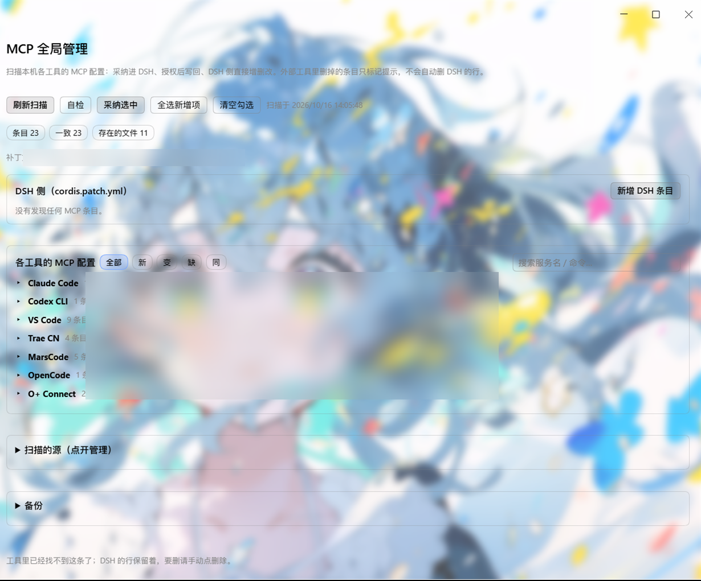
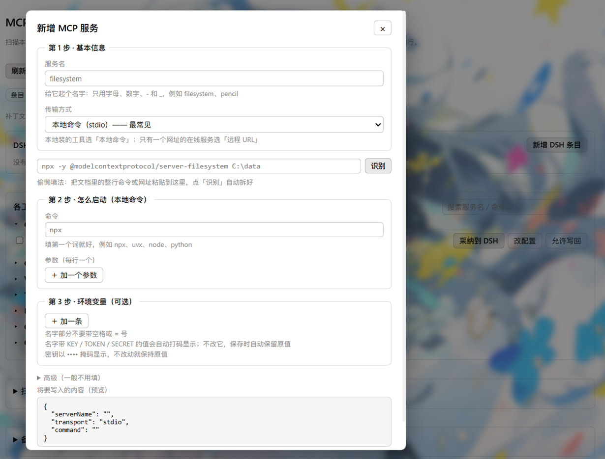
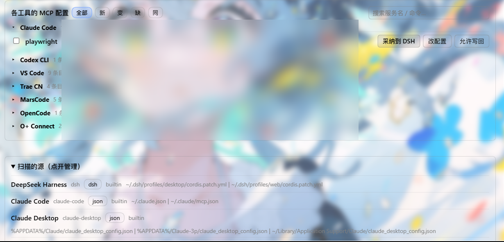
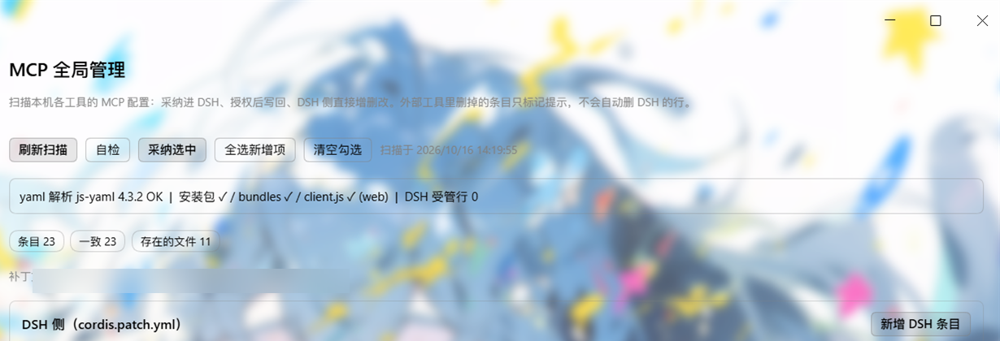

# dsh-mcp-global-manager

DSH 侧栏面板：把散落在本机各编程工具里的 MCP 配置收进一处——扫描差异 → 一键采纳进 DSH → 需要时写回原工具 → DSH 侧直接增删改停用。

*A DSH sidebar panel that scans MCP configs from the tools it knows (28 built-in sources plus custom ones), syncs diffs into DSH, and lets you import, write back, or edit MCP servers.*

MIT · Windows / macOS / Linux · DSH ≥ 0.1.6-alpha · 不出网 · 不执行命令

## 界面速览

> 以下截图中的本机绝对路径已做模糊处理，仅保留 `~` / `%APPDATA%` 通用占位。

**① 扫描总览** —— 顶部状态徽章（条目 / 一致 / 存在的文件）+ 按工具分组的差异账本，新/变/缺/同四态一目了然：



**② DSH 侧新增** —— 三步表单（基本信息 / 怎么启动 / 环境变量），支持整行命令粘贴「识别」自动拆好，底部实时预览将要写入的内容：



**③ 来源注册表** —— 28 个内置源 + 自定义源，每条带 `builtin` 徽章与多平台候选路径，可点开展开管理、增删自定义源：



**④ 自检横幅** —— 面板内「自检」一键校验 js-yaml 解析、安装包/bundles/client.js 是否就位、DSH 受管行数：



---

## 为什么需要它

MCP 配置散在 Claude Code / Codex / VS Code / Cursor / Trae / Kiro / OpenCode / Cline / Gemini CLI 等 28 个已登记源（外加自定义源）的配置文件里，同名条目（比如 `pencil` 出现在 5 个工具里）改一处忘三处。这个插件做三件事：

1. **发现**：按注册表扫每个工具的配置文件，识别各自方言（JSON / TOML / OpenCode / Continue 数组形态，`//` 注释与尾随逗号都能吃）。
2. **同步**：勾选后写进 DSH profile 的 `cordis.patch.yml`，生成 `@deepseek-ai/dsh-mcp-client` 受管行（与 `dsh-mcp-manager-plus` 的行形状互通，彼此认得对方的行）。
3. **管理**：DSH 侧的新增 / 编辑 / 删除 / 停用直接在面板做；写回原工具需在条目上逐条显式授权。

侧栏入口：地球图标 + **MCP全局管理**（`order: 22`，排在 dsh-remote-web-ui「远程链接」的 21 后面；没装那个插件也照常可用）。

## 功能一览

- **扫描**：28 个内置源 + 自定义源；400ms 请求级缓存，连点「刷新扫描」不会把磁盘扫穿。
- **差异账本**：`无变化 / 新发现 / 有变化 / 源里已删` 四态指纹；JSON 键序重排不误报；同名条目跨工具互相点名（`重复于: Trae CN, Cursor`）。
- **采纳导入**：勾选批量或单条导入；`--emit` 预览与真实导入共用同一个纯函数，「说写几行」＝「真写几行」。
- **写回原工具**：逐条打开「允许写回」＋ 确认弹窗 ＋ 服务端账本双重闸门；**没有任何 force 旁路参数**。
- **DSH 侧管理**：增删改停用；每次写盘前做结构校验，认不出主行宁可拒绝也不误删。
- **密钥安全**：名字命中 `KEY`/`PASSWORD`/`SECRET`/`TOKEN`/`AUTH`/`BEARER`/`COOKIE`/`CRED` 任一（不分大小写）的 env 键与请求头，以及 URL 查询串里的同名令牌，面板一律打码显示；写回时服务端用磁盘原值逐条还原，还原不了（源文件里压根没有这条真值）直接 409 拒写——任何配置文件都不会被写进那八个圆点。
- **备份**：每次写入前自动备份到 `~/.dsh/mcp-global-manager/backups/`，最多保留 40 份。
- **自检**：一键输出 js-yaml 可用性 / 客户端包三项 / DSH 受管行数，专治「现在能用、重启就崩」。
- **双语界面**：中英文案跟随 DSH 语言。

## 安装

用 DSH 自带的插件命令，`--profile` 换成你实际在用的 profile 名（`web` / `desktop` / `tui` …）：

```powershell
# ① 从 GitHub 装（推荐，无需 npm 账号）
dsh plugin --profile web add asfre/dsh-mcp-global-manager

# ② 从源码装（开发态）
dsh plugin --profile web add file:C:/Users/you/dsh-plugins/dsh-mcp-global-manager

# ③ 装 GitHub Release 上的预构建 tarball（需先发版，版本号钉死）
dsh plugin --profile web add https://github.com/asfre/dsh-mcp-global-manager/releases/download/v0.1.1/dsh-mcp-global-manager-0.1.1.tgz
```

> npm 尚未发布；发布后第 ① 步可改用 `dsh plugin --profile web add dsh-mcp-global-manager`（市场会额外显示下载量）。

装完**彻底重启** DSH（托盘右键退出再打开——`Ctrl+R` 只重载前端，宿主进程里的 `lib/*.js` 还是旧的），侧栏「远程链接」正下方就会出现 **MCP全局管理**。

## 面板怎么用

1. 侧栏点 **MCP全局管理**，顶部 **刷新扫描**。
2. 徽章一行：总数 / 新发现 / 有变化 / 源里已删 / DSH 已管 / 存在的文件 / 读取失败。
3. 「各工具的 MCP 配置」每个源一块：勾选 → **采纳选中**；或单条 **采纳到 DSH**。
4. 单条 **改配置** 编辑；先开 **允许写回**，才会出现 **写回该工具 / 从该工具删除**（改的是别的工具的配置文件，会先弹确认框）。
5. 「DSH 侧」做增删改与停用；**新增 DSH 条目** 手工建一条。
6. 遇到「源里已删」只标红不自动删，要删得亲手点；想彻底清账本，删 `~/.dsh/mcp-global-manager/state.json` 下次扫描全新开始。
7. 服务名进 DSH 前会规范化非 `[A-Za-z0-9_-]` 字符（`API 文档` → `API`，纯中文 → `server-<hash6>`），面板会提示改名。

## 安全与权限（收录披露）

**它会做什么：**

- **读**：扫描注册表内各工具的 MCP 配置文件（默认全程只读）。注册表标只读的源（lingma / cherry-studio / zed / warp / continue）点写回会被 403 挡下。
- **写**：只有两处——① 采纳/DSH 侧管理写 profile 的 `cordis.patch.yml`（先校验后备份再原子写）；② 你在某条上开过「允许写回」并确认，才写那个工具自己的配置文件。
- **落盘数据**：仅 `~/.dsh/mcp-global-manager/`（`state.json` 差异账本 + `backups/` 写前备份），在插件目录之外，也不随仓库分发。

**它不会做什么：**

- **不联网**：宿主侧不开任何出网连接；浏览器侧只与本机 `/mcp-global/*` 通信。不上传、不上报你的配置。
- **不执行命令**：不会为装 MCP server 跑 `npx` / `git` / 下载脚本，只改配置文本。
- **不需要密钥**：插件自身不持有任何独立凭据，只搬运你配置里已有的 token（显示与接口返回都打码）。但要坦白：差异账本 `state.json` 会为每条扫到的条目保留**上次的原值快照**（含 env 里的 token 明文），用于「消失条目回补展示」和写回还原——它只落你本机磁盘、绝不出网。如果这台机器有多用户或远程控制软件，注意 `~/.dsh/mcp-global-manager/` 的目录权限。
- **不越权**：API 只监听 loopback，且 Origin 必须与 Host 相等、Host 还必须是字面量 `127.x.x.x / localhost / [::1]`（挡 DNS 重绑定）。同站的 CSRF 一律 403。同时要说清：**loopback 端口对本机任意进程可见**，跑不受信程序的机器上别指望这层隔离。本地脚本不带 `Origin`、桌面壳用自定义协议源，正常放行。
- **不提权**：只用当前登录用户的文件权限。

⚠️ 提醒：不少工具（如 Trae CN 的 Apifox 条目）把 token **明文**存在自己的配置里，本插件不改变这一点——别把那些文件原样贴给别人或提交进仓库。

**写回完整性**：任何写盘都走 `读原文 → 纯函数改 → 结构校验 → 回读验证 → 备份 → 原子写`，任一环节不过整笔取消，磁盘一个字节不动。

## 自定义源

内置清单之外的新工具：面板「扫描的源」里加一条自定义源（id / 格式 / 容器键 / 候选路径，支持 `%APPDATA%` 等环境变量展开），标 **允许写回** 才会真写。

## 已知限制

- JSON 源写回时 `//`、`/* */` 注释与尾随逗号会**丢失**（读能容错，还原不了）；写前必有备份，丢了可回滚。
- TOML 只处理 `[mcp_servers.x]` 一层；`.env` / `.http_headers` 子表写回时展平成 `env = { K = "V" }`。
- 面板管的是**配置**，不代管 DSH 的 MCP 运行状态（启不启得来看 DSH 的 MCP 层）。
- 补丁 `id` 命名空间全 profile 共享：停用/删除/改名三个操作都先确认补丁里存在这条受管服务器行，认不出主就 409/404 拒绝。服务名避开 `manager-plus` 一类与插件同名的前缀即可。
- 兼容性：`@deepseek-ai/dsh` 的 `>=0.1.6-alpha.1 <0.2.0-0` 或 `>=0.2.0-rc.1 <0.3.0-0`（0.2.0 正式版前的过渡版本不支持）。

## 开发与自测（零写入）

```powershell
node tools/cli-scan.mjs            # 只扫描打印；--emit 预览导入 YAML
node test/run.mjs                  # 后端单测（含写路径沙箱演练）
node tools/smoke-client.mjs        # 面板渲染冒烟（React 桩，拦整页白屏）
node tools/cold-start-check.mjs    # 冷启动演练：等价「重启后用户的第一次点击」
```

改源码后同步进 profile：`powershell -ExecutionPolicy Bypass -File tools/sync-to-profile.ps1`，然后按改动侧决定 `Ctrl+R`（仅客户端）或彻底重启（宿主 `lib/*.js`）。

⚠️ **js-yaml 版本坑**（社区装机最常见的「重启后崩」）：补丁方言依赖 js-yaml 4.x 的 `Type` 构造器，`package.json` 已显式声明 `dependencies`，但 profile 的 hoisted 目录可能被别的插件的 5.x 占位。`resolveYaml()` 会按能力挑副本（标准解析 → `.pnpm/js-yaml@4.x` → 邻居目录兜底）。装完务必重启后点一次 **自检**。

## 卸载

从 profile 移除这条依赖（`dsh plugin remove` 或删 `dsh.profile.bundles` 里的条目），刷新界面即可。DSH 补丁里已生成的 `mcp-*` 行**不会**跟着消失——那是你的配置，不是插件的东西；需要的话在面板里逐条删。账本与备份在 `~/.dsh/mcp-global-manager/`，一并删除即彻底清理。

## 更新日志 / Changelog

每个版本的「更新了什么 + 适用 Harness 版本」以中英双语记录在 [CHANGELOG.md](./CHANGELOG.md)，同时也是 GitHub Release 的说明来源。

## License

MIT
